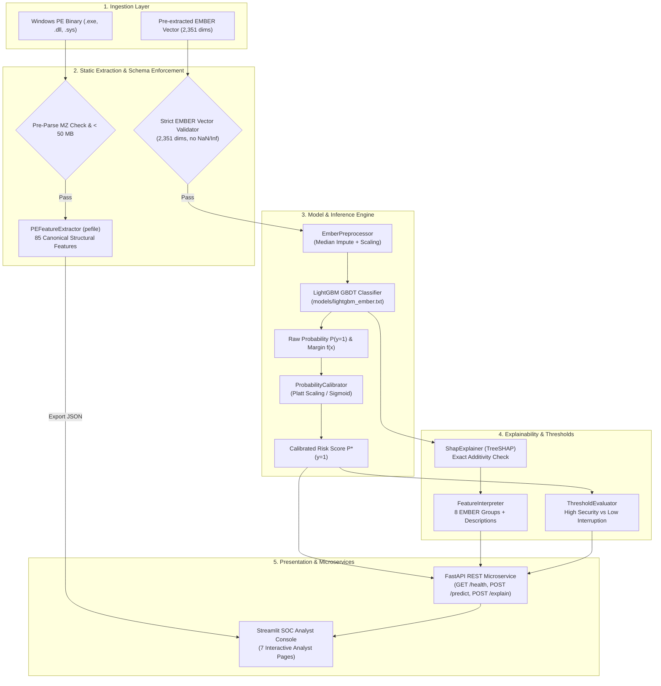

# ThreatLens — System Architecture & Component Design

## 1. System Overview

ThreatLens is an explainable AI-powered static malware analysis platform for Windows Portable Executable (PE) binaries. It bridges static structural analysis, gradient-boosted decision trees, probability calibration, local and global SHAP attributions, an asynchronous FastAPI REST microservice, and a Streamlit SOC Analyst Console.

---

## 2. End-to-End Architecture Flowchart



---

## 3. Strict Pipeline Isolation Rationale

ThreatLens enforces a strict architectural boundary between two incompatible pipelines:

```
+-----------------------------------------------------------------------------------+
| PIPELINE A: EMBER 2018 Track                                                      |
| - Dimensions: 2,351 continuous/discrete features                                  |
| - Features: Byte histograms, 2D entropy, string stats, MurmurHash tables          |
| - Model: LightGBM GBDT binary classifier trained on EMBER benchmark schema        |
| - Consumed by: MalwareClassifier, ShapExplainer, ProbabilityCalibrator            |
+-----------------------------------------------------------------------------------+
                                        ≠ (STRICTLY ISOLATED)
+-----------------------------------------------------------------------------------+
| PIPELINE B: ThreatLens Custom PE Track                                            |
| - Dimensions: 85 structural features                                              |
| - Features: pefile headers, section Shannon entropies, permissions, API counts    |
| - Philosophy: Semantic clarity without hashing collisions                         |
| - Consumed by: PEFeatureExtractor, ThreatLensCoreAdapter                          |
+-----------------------------------------------------------------------------------+
```

> [!CAUTION]
> Custom 85-dimensional PE features are **never silently mapped, zero-padded, or heuristic-aligned** into the 2,351-dimensional EMBER model. Attempts to pass 85-feature inputs into `MalwareClassifier` raise an explicit [`IncompatibleFeatureError`](file:///C:/Users/ALPHA_JUNIOR/MalExplain/threatlens/core/adapter.py#L32-L36).

---

## 4. Component Breakdown

| Module | Core Classes | Functionality |
| :--- | :--- | :--- |
| `threatlens.core` | [`PEFeatureExtractor`](file:///C:/Users/ALPHA_JUNIOR/MalExplain/threatlens/core/extractor.py), [`FeatureVectorAdapter`](file:///C:/Users/ALPHA_JUNIOR/MalExplain/threatlens/core/adapter.py) | Non-executing PE binary structural parsing and schema validation. |
| `threatlens.model` | [`MalwareClassifier`](file:///C:/Users/ALPHA_JUNIOR/MalExplain/threatlens/model/classifier.py), [`ProbabilityCalibrator`](file:///C:/Users/ALPHA_JUNIOR/MalExplain/threatlens/model/calibration.py), [`ThresholdEvaluator`](file:///C:/Users/ALPHA_JUNIOR/MalExplain/threatlens/model/threshold_analysis.py) | LightGBM inference, Platt scaling probability calibration, and operational posture analysis. |
| `threatlens.explainability` | [`ShapExplainer`](file:///C:/Users/ALPHA_JUNIOR/MalExplain/threatlens/explainability/explainer.py), [`GlobalExplainer`](file:///C:/Users/ALPHA_JUNIOR/MalExplain/threatlens/explainability/global_explanations.py), [`FeatureInterpreter`](file:///C:/Users/ALPHA_JUNIOR/MalExplain/threatlens/explainability/feature_interpreter.py) | TreeSHAP local additive explanations, feature rankings, and EMBER group rollups. |
| `threatlens.api` | [`ModelContainer`](file:///C:/Users/ALPHA_JUNIOR/MalExplain/threatlens/api/dependencies.py), FastAPI routers | Asynchronous REST service with lifespan singleton caching and Pydantic v2 schemas. |
| `threatlens.dashboard` | [`ThreatLensAPIClient`](file:///C:/Users/ALPHA_JUNIOR/MalExplain/threatlens/dashboard/api_client.py), Streamlit app | 7-page dark SOC console with interactive Plotly visual charts and dynamic model status badges. |
| `threatlens.data` | [`EmberDatasetAcquisition`](file:///C:/Users/ALPHA_JUNIOR/MalExplain/threatlens/data/download_ember.py) | Verified, resumable acquisition of the genuine EMBER 2018 dataset with SHA-256 validation. |
