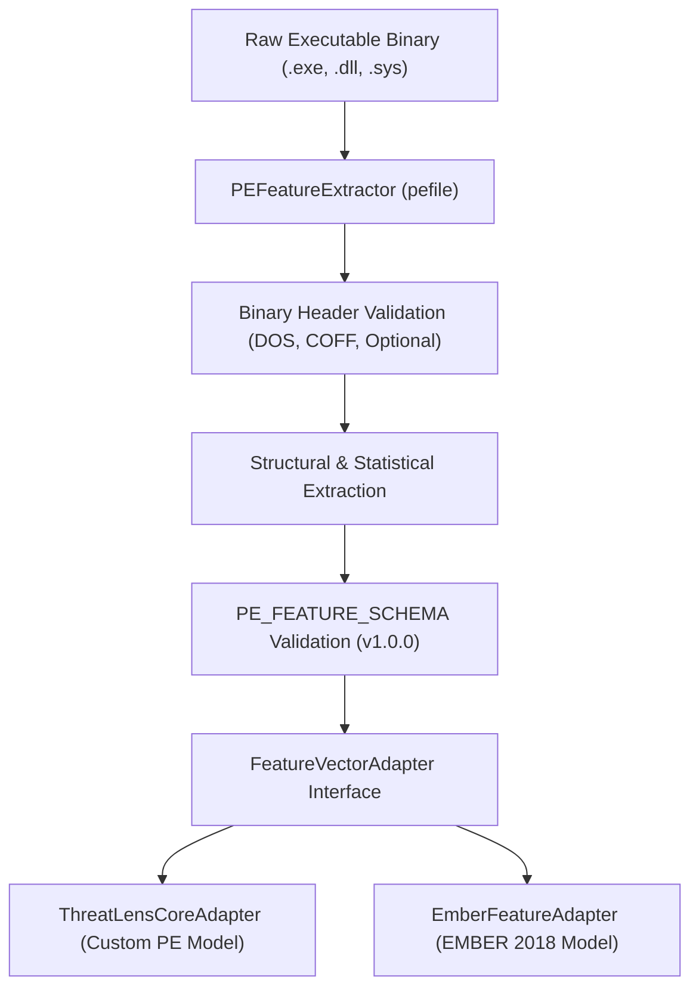
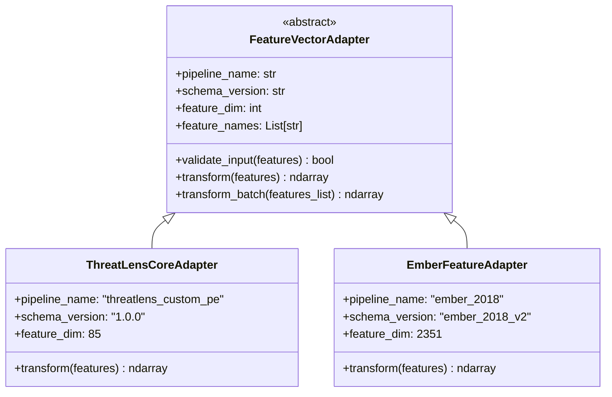

# ThreatLens PE Static Feature Extraction Specification

**Stage**: Stage 2 – Static PE Feature Extraction & Model Adapter Interface  
**Version**: 1.0.0  
**Target Architecture**: Windows PE32 / PE32+ Executables  

---

## 1. Static Analysis Methodology

ThreatLens static analysis inspects Windows Portable Executable (PE) binaries strictly without execution. The system parses headers, section tables, symbol descriptors, import and export address tables, resource directory hierarchies, and appended overlay payloads using `pefile`.



> [!IMPORTANT]
> **Safety Guarantee**: The extractor performs byte-level parsing only. Binaries are never mapped into an executable process space, dynamically resolved, or launched.

---

## 2. Extracted Feature Categories

The ThreatLens extractor extracts 62 canonical structural properties organized across 7 categories:

### A. File Information
- `file_size`: Total size of the file on disk in bytes.
- `file_type`: Binary classification (`PE32` for 32-bit x86, `PE32+` for 64-bit AMD64/ARM64).
- `machine_architecture`: Numerical processor ID from COFF header (e.g. `0x14C` for i386, `0x8664` for AMD64).
- `machine_name`: Resolved processor identifier name.
- `pe_timestamp`: Unix epoch compilation timestamp stored in the COFF header.
- `pe_timestamp_iso`: Standard ISO 8601 UTC representation of compilation date.
- `checksum`: Header checksum field located in the Optional Header.

### B. PE Headers
- **DOS Header**:
  - `dos_header_magic`: `0x5A4D` (`MZ`).
  - `dos_header_pe_link`: `e_lfanew` offset pointing to the NT headers.
  - Decoded DOS fields: `e_cblp`, `e_cp`, `e_crlc`, `e_cparhdr`, `e_minalloc`, `e_maxalloc`, `e_ss`, `e_sp`, `e_csum`, `e_ip`, `e_cs`, `e_lfarlc`, `e_ovno`.
- **COFF File Header**:
  - `file_header_characteristics`: 16-bit characteristics bitmask.
  - `file_header_number_of_sections`: Count of section headers recorded in COFF table.
  - `file_header_pointer_symbol_table`: File offset to symbol table.
  - `file_header_number_of_symbols`: Number of COFF symbols.
  - `file_header_size_optional_header`: Size of the following Optional Header.
  - Interpreted boolean flags: `relocs_stripped`, `executable_image`, `line_nums_stripped`, `local_syms_stripped`, `large_address_aware`, `32bit_machine`, `debug_stripped`, `removable_run_from_swap`, `net_run_from_swap`, `system`, `dll`, `up_system_only`.
- **Optional Header**:
  - `entry_point`: Relative Virtual Address (RVA) of the entry point.
  - `image_base`: Preferred base address in virtual memory.
  - `subsystem`: Numerical operating system subsystem ID.
  - `subsystem_name`: Subsystem descriptor (e.g. `IMAGE_SUBSYSTEM_WINDOWS_GUI`, `IMAGE_SUBSYSTEM_WINDOWS_CUI`).
  - `optional_header_magic`: `0x10B` (PE32) or `0x20B` (PE32+).
  - Linker versions: `optional_header_major_linker_version`, `optional_header_minor_linker_version`.
  - Code and data sizes: `optional_header_size_of_code`, `optional_header_size_of_initialized_data`, `optional_header_size_of_uninitialized_data`.
  - Section RVAs: `optional_header_base_of_code`, `optional_header_base_of_data` (present in PE32, `None` in PE32+).
  - Virtual sizes: `optional_header_image_size`, `optional_header_size_of_headers`.
  - Alignment: `optional_header_section_alignment`, `optional_header_file_alignment`.
  - Stack and Heap reserves: `optional_header_size_of_stack_reserve`, `optional_header_size_of_stack_commit`, `optional_header_size_of_heap_reserve`, `optional_header_size_of_heap_commit`.
  - `optional_header_number_of_rva_and_sizes`: Number of Data Directory entries.
  - DLL characteristics flags: `high_entropy_va`, `dynamic_base` (ASLR), `force_integrity`, `nx_compat` (DEP), `no_isolation`, `no_seh`, `no_bind`, `appcontainer`, `wdm_driver`, `guard_cf` (Control Flow Guard), `terminal_server_aware`.

### C. Sections
- `number_of_sections`: Total number of parsed sections.
- For each section:
  - `index`: Numerical index (0-based).
  - `name`: ASCII section identifier (e.g. `.text`, `.data`, `.rdata`, `.rsrc`, `.reloc`).
  - `virtual_address`: RVA where the section is loaded.
  - `virtual_size`: Allocated memory space for the section.
  - `size_of_raw_data`: Physical size on disk.
  - `pointer_to_raw_data`: File offset to raw data bytes.
  - `entropy`: Shannon entropy (0.0 to 8.0).
  - `characteristics`: Section characteristic bitmask.
  - `permissions`: Interpreted flags (`readable`, `writable`, `executable`, `shared`, `contains_code`, `contains_initialized_data`, `contains_uninitialized_data`).

### D. Imports
- `number_of_imported_dlls`: Count of imported shared libraries.
- `number_of_imported_functions`: Total count of imported API routines.
- `imported_dll_names`: List of imported DLL filenames.
- `imports`: Nested structure containing each DLL and its imported functions (name, ordinal, bound address).
- `unusual_import_characteristics`:
  - `has_empty_dll_names`: Indicates corrupted or obscured import tables.
  - `has_ordinal_only_imports`: Functions imported strictly by ordinal number without symbolic names.
  - `suspicious_import_count`: Count of flagged high-impact system calls.
  - `suspicious_imports_found`: List of identified sensitive APIs (e.g., `VirtualAlloc`, `WriteProcessMemory`, `CreateRemoteThread`, `IsDebuggerPresent`).

### E. Exports
- `number_of_exports`: Count of exported function symbols.
- `export_names`: List of exported API names.
- `exports`: List of exported entry points (name, ordinal, RVA).

### F. Resources
- `has_resources`: Boolean indicator of resource directory presence.
- `resource_count`: Count of individual leaf resource objects.
- `resource_types`: Unique types discovered (e.g. `RT_ICON`, `RT_VERSION`, `RT_MANIFEST`).
- `resources`: Detailed list of each resource entry with type, resource ID, language ID, and raw size in bytes.

### G. Additional Characteristics
- `overlay_size`: Extraneous byte count located beyond the final section on disk.
- `has_overlay`: Presence flag for overlay payload.
- `overlay_entropy`: Shannon entropy of the overlay data.
- `certificate_table`: Security certificate data directory presence, RVA, and byte size.
- `debug_entries_count`: Number of debug directory records.
- `has_debug_data`: Boolean indicator of debug information.
- `debug_types`: Categorized debug information types (e.g., `IMAGE_DEBUG_TYPE_CODEVIEW`, `IMAGE_DEBUG_TYPE_POGO`).

---

## 3. Heuristic Interpretation Guidelines

> [!WARNING]
> **Heuristic Indicators vs. Malware Proof**:
> High entropy, unusual section permissions (such as W+X sections), and uncommon API imports are **suspicious indicators requiring human and model investigation**, NOT definitive proof of malicious intent.

1. **Entropy Interpretation**:
   - Standard compiled code sections (`.text`) typically exhibit entropy values between `5.8` and `6.6`.
   - Entropy exceeding `7.2` generally indicates packing, compression (e.g. UPX), or encryption.
   - However, benign applications frequently use compression or packing (e.g. game installers, packaged Python interpreters, protected commercial DRM, software updaters).
2. **Permissions (W+X Sections)**:
   - Sections configured with both `writable` and `executable` permissions (`IMAGE_SCN_MEM_WRITE | IMAGE_SCN_MEM_EXECUTE`) permit self-modifying code or runtime unpacking.
   - While common in packers and malware stagers, legitimate JIT compilers (.NET, Java, V8, PyPy) and software protectors also allocate or configure W+X regions.
3. **Import Analysis**:
   - APIs like `VirtualAlloc`, `WriteProcessMemory`, `CreateRemoteThread`, and `LoadLibrary` are required for process injection and DLL loading.
   - However, debuggers, system monitors, profiling tools, antivirus agents, and legitimate runtime loaders also make extensive use of these APIs.

---

## 4. Shannon Entropy Calculation

Entropy quantifies the degree of randomness or compression within a byte sequence $X$:

$$H(X) = -\sum_{i=0}^{255} p(b_i) \log_2 p(b_i)$$

Where $p(b_i)$ is the empirical probability of byte value $b_i$ within the sequence.

- **Range**: $0.0 \le H(X) \le 8.0$ bits per byte.
- Zero entropy ($H = 0.0$) indicates completely uniform or repeated single-byte data (e.g. all null bytes).
- Maximum entropy ($H = 8.0$) represents an equal uniform distribution across all 256 possible byte values (indicative of strong encryption or modern compression).

---

## 5. Model Adapters and Pipeline Isolation

ThreatLens enforces an absolute architectural separation between:

1. **EMBER 2018 Pipeline**:
   - Official 2,351-dimensional benchmark representation.
   - Derived from raw byte histograms, 2D byte-entropy histograms, printable string statistics, and hashed structural tables.
2. **ThreatLens Custom PE Pipeline**:
   - 85-dimensional numerical feature vector derived from direct static structural PE parsing (`pefile`).
   - Specifically engineered for custom LightGBM models and fast edge analysis.



> [!CAUTION]
> `EmberFeatureAdapter` strictly rejects custom PE feature dictionaries. Silent mapping or zero-padding custom features into an EMBER feature vector is forbidden to prevent silent model invalidation.

---

## 6. CLI Usage Examples

### Extract and Inspect PE Features:
```bash
python scripts/extract_features.py path/to/sample.exe --strict
```

### Save Extracted JSON Features:
```bash
python scripts/extract_features.py path/to/sample.exe -o artifacts/sample_features.json
```

### Extract with 85-Dimensional Model Feature Vector:
```bash
python scripts/extract_features.py path/to/sample.exe --vectorize -o artifacts/sample_vectorized.json
```

---

## 7. Sample JSON Output

```json
{
  "file": "sample_binary.exe",
  "features": {
    "schema_version": "1.0.0",
    "file_size": 103192,
    "file_type": "PE32+",
    "machine_architecture": 34404,
    "machine_name": "IMAGE_FILE_MACHINE_AMD64",
    "pe_timestamp": 1680655399,
    "pe_timestamp_iso": "2023-04-05T00:43:19+00:00",
    "checksum": 110291,
    "entry_point": 4816,
    "image_base": 5368709120,
    "subsystem": 3,
    "subsystem_name": "IMAGE_SUBSYSTEM_WINDOWS_CUI",
    "dos_header_magic": 23117,
    "dos_header_pe_link": 264,
    "file_header_characteristics": 34,
    "file_header_number_of_sections": 6,
    "characteristics": {
      "relocs_stripped": false,
      "executable_image": true,
      "large_address_aware": true,
      "32bit_machine": false,
      "dll": false
    },
    "optional_header_magic": 523,
    "optional_header_size_of_code": 3584,
    "optional_header_base_of_data": null,
    "dll_characteristics_flags": {
      "dynamic_base": true,
      "nx_compat": true,
      "guard_cf": true
    },
    "number_of_sections": 6,
    "sections": [
      {
        "index": 0,
        "name": ".text",
        "virtual_address": 4096,
        "virtual_size": 3392,
        "size_of_raw_data": 3584,
        "pointer_to_raw_data": 1024,
        "entropy": 5.7603,
        "characteristics": 1610612768,
        "permissions": {
          "readable": true,
          "writable": false,
          "executable": true,
          "shared": false,
          "contains_code": true
        }
      }
    ],
    "number_of_imported_dlls": 1,
    "number_of_imported_functions": 1,
    "imported_dll_names": ["python310.dll"],
    "unusual_import_characteristics": {
      "has_empty_dll_names": false,
      "has_ordinal_only_imports": false,
      "suspicious_import_count": 0,
      "suspicious_imports_found": []
    },
    "number_of_exports": 0,
    "has_resources": true,
    "resource_count": 4,
    "has_overlay": false,
    "overlay_size": 0,
    "overlay_entropy": 0.0,
    "certificate_table": {
      "present": true,
      "virtual_address": 91136,
      "size": 12056
    },
    "has_debug_data": true,
    "debug_entries_count": 3
  }
}
```
